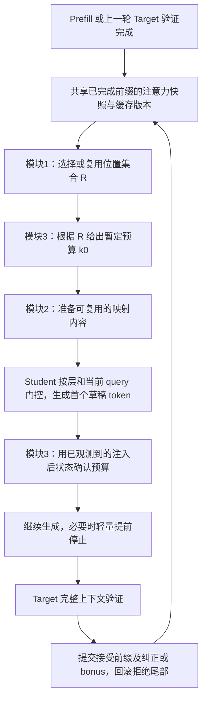

# 三模块调度对齐与实现核查

日期：2026-10-17。代码基准：`9740a04`。这是源码检查和已有记录的 CPU 重算，
不是新一轮 GPU 质量或加速实验；冻结实验文件保持原样。
重算入口：[analyze.py](../exp/scheduling_audit/analyze.py)，
机器可读结果：[audit.json](../exp/scheduling_audit/audit.json)。

## 判断

确实存在可避免的计算、缓存搬运和同步，也存在目标架构与运行路径不一致的问题。
但目前不能把组合后的全部负收益归因于调度：模块单独提高接受量，不保证组合后提高
单位时间提交量；新覆盖选择尚无模型结果，长度/节点预算策略也尚未证明净加速。

需要分别回答三件事：最终输出是否正确、是否实现了约定的三模块语义、成本是否值得。
现有受测输出一致；后两项仍有明确缺口。

## 要对齐的执行架构

这保留“1、3 先规划，2 按位置和预算执行”的主线，同时让 3 在已取得注入后状态时
确认预算。确认应复用首个正常 Draft forward，不额外运行大模型，也不为了决策额外
完整运行一次小模型。首个 token 已生成不代表已被 Target 接受。

模块 3 是否需要逐 token 更新是可选策略，应先测试只在轮边界/首个 token 决策的版本。
暂定预算可以影响注入预算或复用期，但不能让 mapper 依赖尚未存在的未来 query。

### 三类更新频率

| 频率 | 应做的工作 | 复用与失效规则 |
|---|---|---|
| 选择刷新时 | 构建 R、打包 teacher V、映射静态内容、计算 native V 条件编码及位置索引 | 未变的历史位置按需复用；新增位置补算。注意力 prior 更新时刷新相应 gate 特征 |
| 每轮草稿边界 | 共用覆盖/变化摘要，给出 k0、确认可读位置与快照版本 | 先采用固定刷新间隔，再单独验证注意力触发刷新；不能默认每轮重新搜索全部集合 |
| 每层/当前 query | 当前 query 编码、门控强度、应用 V 修正 | query 相关门控随生成更新；同轮静态 teacher/native 内容不应重复编码 |

选择、映射、长度输入绑定到同一个“已提交前缀、R 版本、teacher 参考时间戳”。
原生 backing KV 与受修正的 working KV 分开；拒绝后丢弃尾部状态和对应派生缓存。
Target 始终使用自己的完整原生 KV。新参考只能来自已完成的 prefill/验证。

同一 GPU 上模型与控制器具有数据依赖，不能把“并发三模块”直接当成无成本。
优先消除重复工作并摊销，再测是否有值得重叠的执行。

## 现有两条路径是否实现了这个架构

| 路径 | 模块1 | 模块2 | 模块3 | 与上述架构的差别 |
|---|---|---|---|---|
| Qwen `C_sequential_V` / `C_joint_V` | 读取保持/有限候选集合 | 四个后层的冻结 gated V mapper | 注入前的 RiskNet 长度选择 | 三类功能已接通，但不是新覆盖选择，未实现注入后确认；预测器没有在注入轨迹上重新训练 |
| 远端 Vicuna CSGB 4K | Target 单模型 chunk Top32，四轮刷新 | Native V，mapper 关闭 | 固定最大深度10，选择总节点预算8/16/24/32 | 是单模块预算预实验，未接入共同选择或选择性 mapper，也不是动态最大深度实验 |

两条路径模型、数据、硬件、精度与计时不同，收益不能拼接，也不能把 Qwen mapper
直接移给 Vicuna。注意力加权内容覆盖仍只有合成成本原型。

Qwen 的真实顺序是 `banks → 构造集合 → 计算特征/定长 → bind injection → draft → verify`。
见 [runtime.py](../exp/attention_horizon/runtime.py) 第129–205行；门控读到当前 query，
但长度模块先于本轮注入，读不到本轮注入后的状态。已注入的前轮状态可能间接影响输入，
不等于实现了本轮的闭环确认。

Vicuna 的顺序是 `上一轮验证 → 按旧工作缓存可读位置选择节点预算 → Root forward →
刷新工作缓存/应用 bridge hook → 扩树`。见归档
[model_classic.py](../exp/specextend_bridgekv/csgb_acceptance_pilot_v3/source/specextend/classic/model_classic.py)
第286–340行，及
[csgb_online_harness.py](../exp/specextend_bridgekv/csgb_acceptance_pilot_v3/source/specextend/csgb_online_harness.py)
第232–318行。当前控制器有意按 Root 真正读到的旧缓存计算覆盖，几何统计正确；
如果要实现“新选择和新注入指导本轮 Root”，需要调整生效边界。
不能只在 Root 之后换缓存，就声称 Root 的分布已经受新内容纠正。

## 已确认的实现开销与接口缺口

1. **Qwen 每个 Draft token、每一层重新 gather 工作 K/V。**
   [attention.py](../exp/attention_selection/attention.py) 第94–114行每次重新构造 indices、
   `unique` 并 `index_select`。同轮远历史集合固定，应该复用工作缓存，只追加新状态。
   当前完整 backing cache 还会随 token 更新，因此只减少 attention 的读取长度，
   没有省掉完整状态维护。

2. **静态 mapper 工作重复进入逐 query 路径。**
   [bridge.py](../exp/selective_kv/bridge.py) 第31–57、84–102行每层每 query 重跑
   teacher encoder/decoder、native 编码、位置/prior 特征，重新 searchsorted，clone 工作 V，
   计算并保存训练惩罚和 gate 统计。固定历史位置在一次 bind 内的 source/native 不变，
   proposal、scale、delta、native latent 可以缓存；只保留 query 编码与门控为动态计算。
   运行期不读取的惩罚与统计应关闭。缓存必须在 source/native/mapper 权重改变时失效；
   跨轮还要独立处理 prior 更新。不能缓存一次当前 query 的最终门控以后一直复用。

3. **机制观测过重且有未使用的采集。**
   Qwen runtime 的 probe 开启时，controller 在28层构建完整长度的展开注意力/可见掩码，
   实际风险输入主要消费最后层 full-key shadow；observer 又在最后层读取完整原生 K 计算
   QK/softmax。见 [attention.py](../exp/attention_selection/attention.py) 第137–143行，
   [experiment.py](../exp/attention_horizon/experiment.py) 第97–106行。
   此外 `feature_vector` 为只用结构或纯注意力的模型也计算了随后被丢弃的读出误差；
   `banks` 在无须读出目标的完整/低成本路线仍转换全历史 V 并求 A·V。
   应按消费者采集、按 feature group 计算。关闭 full-key shadow 会改变方法输入，
   需要重新训练/校准；关闭不被消费的采集可先做等价优化。

4. **Qwen 显式同步以及 Python/GPU 往返多。**
   [runtime.py](../exp/attention_horizon/runtime.py) 第143、164、171、187、205、235行
   分别等待阶段或 token 完成；逐 token `int(argmax)`、选择交换中的 `float/int`、
   长度评分中逐候选标量取回也引入等待。部署计时应以整请求边界同步为准，
   stage profiling 单独开启，尽量留在 device 上传递 token 并批量评分。
   消除显式 synchronize 不等于消除主机分支所需的隐式等待。

5. **联合候选搜索重复付费。**
   [runtime.py](../exp/attention_horizon/runtime.py) 第136–156行每轮构造 teacher、
   read_teacher、read_joint1 三个集合，再分别计算特征和运行长度预测。
   可共享排序、已有读出与候选边际，批量预测；应先验证一个 R 的顺序版本。
   多搜索集合必须用新增提交效率补偿额外规划成本。

6. **长度策略没有对注入后的接受分布和成本重新校准。**
   [run.py](../exp/attention_horizon/run.py) 的 collection 方法不含 inject，测试阶段才
   给所选策略追加 inject。`choose_length` 使用单一的 student_step、cache_update 和
   verify 拟合，没有 mapper/gate 条件成本。`spent` 覆盖部分已发生规划，不含紧接着
   的 source_pack，也不含注入增加的未来 token 成本。改变执行后端后旧成本也应重测。
   这可能让控制器选择不划算的长度，但需要新轨迹评估，不能仅凭源码判定损失大小。

7. **Vicuna 已移除显式逐轮同步/训练，但仍有主机等待。**
   每轮将完整 teacher attention 复制到 CPU，NumPy 算覆盖/JS，再采样预算。
   此外 [opt_tree.py](../exp/specextend_bridgekv/csgb_acceptance_pilot_v3/source/specextend/shared/opt_tree.py)
   第51行 `pvals = global_top_logits.tolist()` 只服务于已注释的打印，仍执行未使用的拷贝；
   [utils_classic.py](../exp/specextend_bridgekv/csgb_acceptance_pilot_v3/source/specextend/classic/utils_classic.py)
   第94–103行每轮计算 root KL，即使该 pilot 的控制器不消费它。
   parent 回溯还有逐节点 `.item()`。这些共同开销作用于各预算，不能全部归为
   CSGB 独有成本。冻结归档应保留，优化应在新的执行源码与结果目录中进行。

## 从保存计时能量化到哪里

下列 Qwen 值按总耗时/总输出 token 重算，单位 ms/output，不是文档配对 TPS 百分比。
同一条路径内可以比较；不能把它与 Vicuna 整请求指标混算。

| Qwen 路径 | 选择＋决策 | 草稿 | 验证 | 缓存更新 | 全部 decode |
|---|---:|---:|---:|---:|---:|
| C_sequential | 3.586 | 21.612 | 10.646 | 5.123 | 41.140 |
| C_joint | 6.905 | 23.969 | 9.947 | 4.293 | 45.280 |
| C_sequential_V | 3.591 | 24.594 | 10.642 | 5.617 | 44.811 |
| C_joint_V | 6.828 | 26.274 | 9.821 | 4.774 | 48.043 |

联合相对顺序多花4.140 ms/output，其中3.318 ms来自额外选择/决策。
在保持轨迹和其余耗时不变的算术扣除中，去掉这部分仍慢0.822 ms/output：
它也提出了更多 token。不能把“消除额外搜索”写成已证明能逆转吞吐。

同样，B_attention_read 相比 B_best_static 的验证次数从565降到384，但提出的 token
从565增到886；包括全接受后的必要补算，小模型 forward 从985增到1112。
草稿成本13.433→21.052 ms/output，抵消验证和缓存更新的节省。

probe 的成本有直接对照：A_teacher 与 O_teacher_k4 接受/草稿/轮数完全相同，
仅关闭不需要的 shadow/capture 后 decode TPS 配对提高8.90%，CI[8.36%,9.56%]。
这支持优化观测路径，不能单独分辨 shadow、capture 各占多少。

独立 V pilot 的 teacher_token→performance_gated：接受量2.457→2.495 token/轮，
轮数199→198；实际 decode 时间33.627→36.763 ms/output。接受率提高1.75个百分点
并没有带来相同幅度的每轮有效提交提升，不能让 mapper 支付同等百分比成本。

### Vicuna CSGB 的独立账本

48个计时请求/策略合计：fixed8 用2214轮、206.186s；CSGB 用1996轮、210.821s。
这是固定深度下扩大节点预算后的实际计算与采样轨迹，不能只看轮数下降。
CSGB 的1996轮中有570/476/442/508轮分别选择8/16/24/32节点。
非启动决策的平均采样概率约为28.05%/23.19%/26.08%/22.68%，保持较分散的
softmax采样；是否应该部署确定性选择/较低温度，需要训练与验证，不能事后假定更好。

记录的 feature/decision wall 共1.019s，只占整请求0.483%。按原协议先取两个计时
中位数、再平均三个动作流、最后按八文档配对，原 TPS 变化为−2.346%；从每个请求
扣掉自身记录的 decision wall、保持其他时间和轨迹不变后，账面仍为−1.872%。
这是解释用算术，不是优化后吞吐、加速上界或新的置信区间。
该 wall 包含等待 GPU 的时间；额外 teacher 注意力采集也并非全在这个字段里，
不能以0.483%断言全部注意力成本只有这么多。

## 正收益需要满足的条件

对足够长的稳态输出，令 G 为每轮有效提交量、C 为每轮总成本：

\[
\mathrm{TPS}\approx\frac{\mathbb E[G]}{\mathbb E[C]},\qquad
\frac{\mathbb E[G_\mathrm{new}]}{\mathbb E[G_\mathrm{base}]}
>\frac{\mathbb E[C_\mathrm{new}]}{\mathbb E[C_\mathrm{base}]}
\quad\text{才有正收益。}
\]

短请求还必须加入 prefill、末轮截断与 EOS；正式指标使用实际总提交 token/总时间。
G 包括实际可提交的接受前缀及纠正/bonus，不能只拿接受率或 accepted/block 代替。
C 包括选择、特征、mapper、门控、更多被拒绝的草稿、随节点数变化的验证、缓存维护。

“三个模块都轻量”只控制它们直接的计算，还必须控制它们诱导的 Draft/Target 额外工作。
提升 k 或树节点数即使不支付任何 MLP 成本，也可能降低接受率并增加总模型计算。
内容注入改变 query/注意力及接受分布，联合选择还可能缩小上下文，因此收益不必相加。

还要明确比较目标：相对同设置固定 SD 有收益，与超过 Target AR 是两个门槛。
当前 Qwen eager 最快 SD32.63 decode TPS，Target46.90，基础引擎本身也需优化。

## 建议修改顺序

1. 在同一模型对、精度、预算、计时协议下确认上述执行顺序，分别定义线性 k、树深度 d、
   树节点数 b；先让固定 R/固定 k 的基础 SD 路径高效，再接一个稳定选择器。
2. 优先做语义可保持的优化：关未消费采集/训练统计，缓存静态 mapper 和工作 KV，
   复用索引，批量控制评分，关闭部署阶段计时同步和未用 D2H。逐项检查接受轨迹与输出。
   工作 KV 追加/回滚与 RoPE 原始位置尤其需要独立检查。
3. 做会改变策略的调度：按固定间隔或注意力触发刷新 R；M2保留当前 query 门控；
   M3复用正常 Draft forward 取得注入后观测。用新训练轨迹重训/校准 M3及各条件成本，
   设置以验证集确定的固定长度回退。此步需要新实验，不能归类为等价优化。
4. 在统一引擎运行000/100/010/001/110/101/011/111模块开关对照，并同时保留优化前后
   的固定基线。模块关闭时定义为同预算的既定基线，不能把“关模块1”偷换成无条件全上下文。
   报告整请求、decode、prefill、各阶段以及 draft/verify工作量，再判断交互。

## 本次检查与证据边界

- 已有 Qwen 测试保存720/720 SD输出一致，原 V pilot及来源补充合计300/300一致；
  这是受测 greedy 路径的输出证据，不能替代本次新 GPU 重放。
- 本次再次运行 Qwen 的EOS、删失、输出预算和bonus补算检查，四项通过。
- 本次运行归档 cache geometry、terminal commit、attention observation、episode harness、
  corrected request 的64项 CPU 测试，全部通过；包括禁止请求内显式同步/训练更新、
  attention时间戳、Root可读范围、终止前不构造未用草稿。
- CSGB 的全部556保存请求输出一致和归档哈希/CI已在拉取同步时核验通过。
- 当前 Qwen13个源码文件匹配最终 completeness 的哈希；初始 protocol 的旧源码哈希
  保留历史含义。未修改已运行的源码、控制器或报告，也未重新训练或运行完整GPU推理。

后续性能热点的精确归因仍需新引擎的 GPU event/profiler；本次 stage 账本只定位可以
优先修正的路径，不把所有潜在节省量相加当作已取得的加速。

用户随后授权了第一版执行优化；实现与有限 GPU 对照见
[pipeline 报告](../exp/attention_pipeline/REPORT.md)。本核查中的历史记录与判断保留原始范围。
