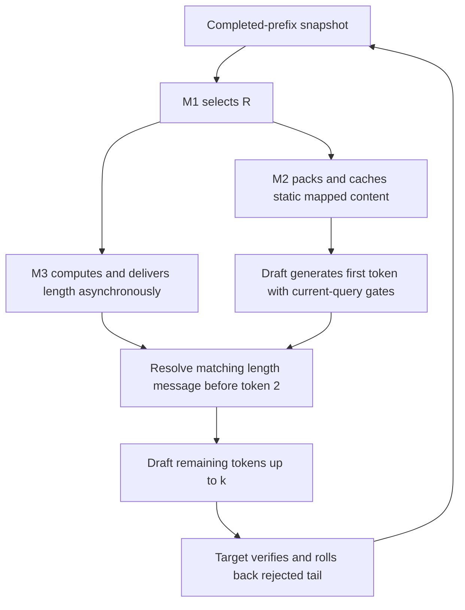

# First-token overlap pipeline

This is a new local execution prototype for the existing Qwen selection,
frozen selective V mapper, and frozen attention/read-risk length predictor.
It does not implement the proposed content-coverage selector or a networked
edge/cloud deployment. Historical execution sources and results stay intact.

The first execution comparison is complete: [results and limits](REPORT.md).
Across 48 timed requests the saved outputs match Target references; the new
serial/cached/async controls preserve their complete length/acceptance traces.
Async is slower with zero added delay and faster with the artificial 10 ms
service delay. These are two training documents, not a held-out speed study.

The first implementation preserves the R dependency of the existing length
features. Module 1 and module 3 are one round's planning stage, but module 3
cannot finish before R exists. Its remaining work runs asynchronously with
module 2 and the first normal Draft forward:



Every supported length is at least one. Consequently, the first token can run
before its length message arrives without generating an extra token. A late
message causes a measured wait before token 2; it is not silently replaced by
a different length. Request/round/prefix/workset keys reject stale messages.
Each request has a fresh UUID, including repeated inputs. Pending work is
drained before state is cleared or reused. The trace records message readiness
at the first-token deadline, the overlap window, and exposed waiting.

For a distributed version, send context/content and the length as independent
versioned messages. Waiting to bundle both before sending R would restore the
serial dependency. Full parallel planning of M1 and M3 requires either an
R-independent controller or a split into R-independent features and a short
R-dependent final decision; the existing predictor is not silently changed to
claim that independence.

## What can be hidden

Let `t_length` be length-message arrival, and `t_deadline` be the end of the
first necessary Draft forward after context arrival. The exposed wait is:

`wait = max(0, t_length - t_deadline)`.

It is insufficient to compare length planning with the time for an entire
draft block: if k=1, starting token 2 before receiving the decision is extra
work. Hidden waiting also does not prove zero total cost: launching tasks,
GPU resource contention, D2H, and real network traffic can still slow the
foreground. This prototype measures complete requests on one H100; it has no
actual RPC, bandwidth, or edge-device measurement. `--delivery-delay-ms` is an
optional artificial service delay, not an observed network latency.

## Implementation

- [planner.py](planner.py): one bounded worker, immutable keys, validated
  length decisions and error propagation. The current transport is local.
- [cached_injection.py](cached_injection.py): cache teacher/native encodings,
  scale, residual, position features and working indices once per bind. The
  query encoder and gate still execute for each active layer/query. Training
  regularizers and gate-stat collection are disabled only in this inference
  path. Backing K/V are not overwritten; cache state is replaced each round.
- [runtime.py](runtime.py): independent CUDA control stream; module 2 plus
  the first Draft forward overlap module 3. Unused expanded attention capture
  is disabled, while the last-layer full-key shadow used by the frozen risk
  predictor is retained. Per-stage/token profiling synchronizations are
  omitted; request boundaries and necessary host decisions still wait.
- [run.py](run.py): randomized-order training-document smoke and separate
  Target references. Every new-control cap/proposed/accepted trajectory must
  match, in addition to exact final output.

## Controls and interpretation

| Control | Purpose |
|---|---|
| legacy_serial | Original `C_sequential_V` implementation, including elapsed-wall `spent`, expanded capture and profiling synchronizations |
| serial_original | New execution loop, original injection, synchronous M3 |
| serial_cached | Same new loop and policy inputs, cached injection, synchronous M3 |
| async_cached | Same new loop, cached injection, M3 overlapped with M2/first token |

New serial/async controls use identical **fixed** `planning_spent_ms` in the
length cost function, default 0, to isolate scheduling from a stopwatch that
would otherwise change k when execution order changes. All other risk and
cost coefficients are frozen. This is a new policy-input protocol; its
trajectory need not equal legacy_serial. The predictor is not retrained or
calibrated for injection by this prototype.

Compare serial_original/serial_cached for static mapping reuse and
serial_cached/async_cached for asynchronous scheduling. Legacy comparisons
also include capture/synchronization and cost-input changes and cannot
attribute all differences to overlap. Each request includes both prefills;
model/checkpoint loading, warmup and standalone Target references are outside
the timing. Timed terminal rounds and required Student catch-up are included.

## Run

```bash
PYTHONDONTWRITEBYTECODE=1 /home/wanghl/miniconda3/envs/rescue/bin/python -m unittest exp.attention_pipeline.test_pipeline -v
PYTHONDONTWRITEBYTECODE=1 /home/wanghl/miniconda3/envs/rescue/bin/python exp/attention_pipeline/run.py
# Optional paired artificial-delay profiles, loading the models only once:
PYTHONDONTWRITEBYTECODE=1 /home/wanghl/miniconda3/envs/rescue/bin/python exp/attention_pipeline/run.py --output exp/attention_pipeline/out_delay_comparison --delivery-delays-ms 0 10
```

The default is two **training** documents, max 32 output tokens, three timing
repeats, one warmup request per mode, fixed checkpoints and randomized mode
order. A new output directory is required for each invocation. It saves code
and weight hashes, frozen source copies, references, raw requests and summaries
under `delay_0ms`, `delay_10ms`, etc. This small run is an
execution/trajectory smoke, not a held-out quality study or evidence that the
complete paper method accelerates over Target AR.

The unit checks cover delayed plans, stale keys, invalid lengths, worker
errors, and exact cached-versus-original V results across different queries
and growing working caches. Rebinding and zero injection are also checked.
