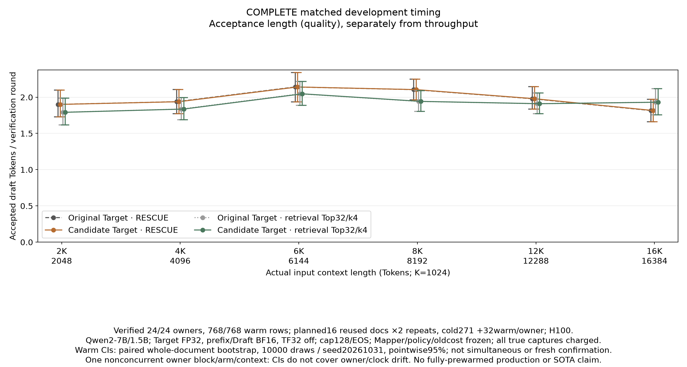
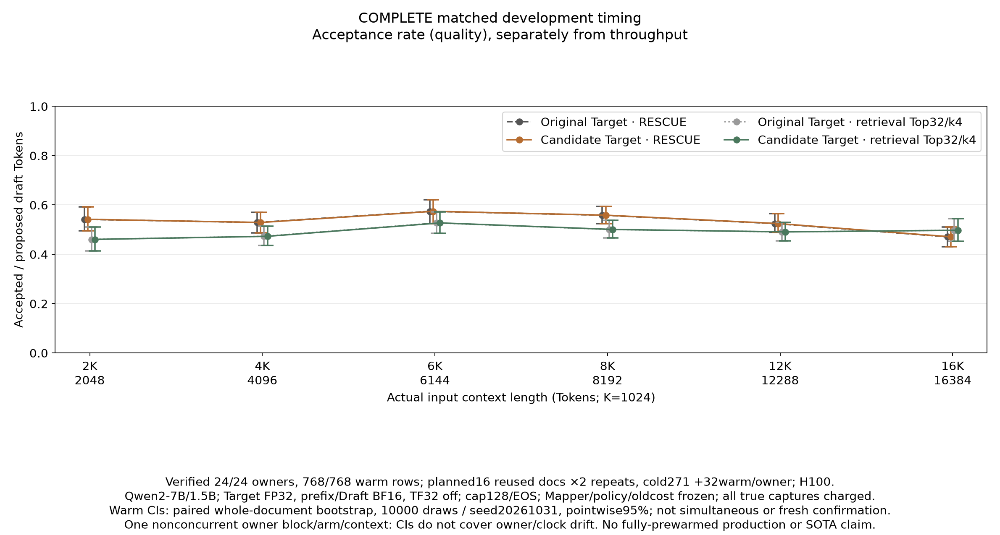
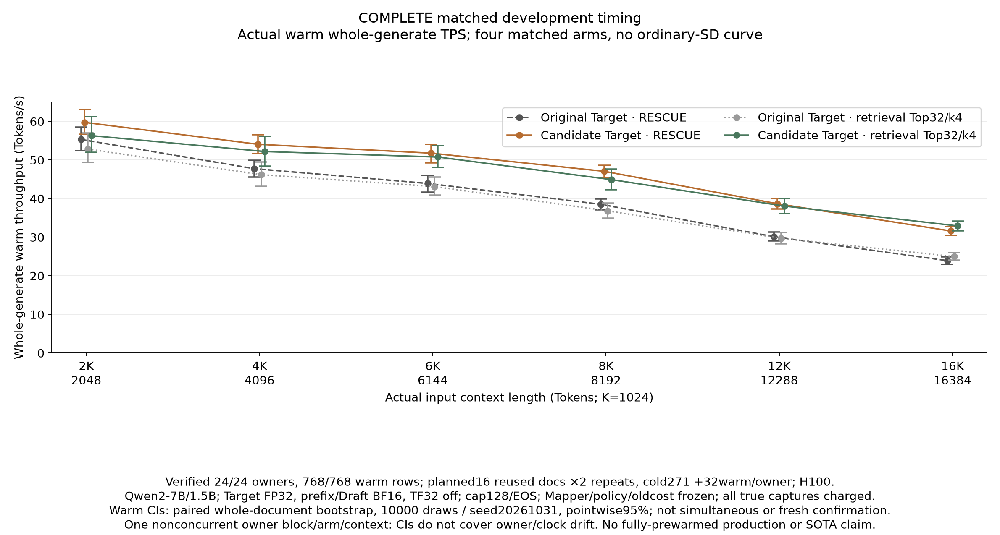
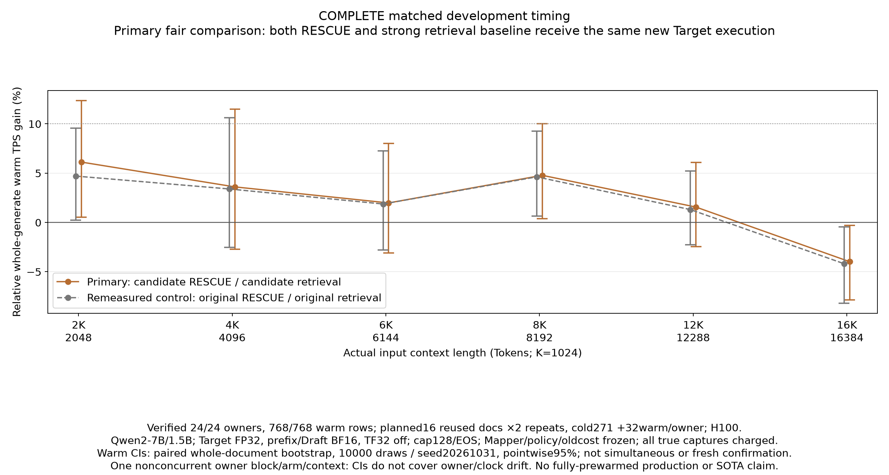
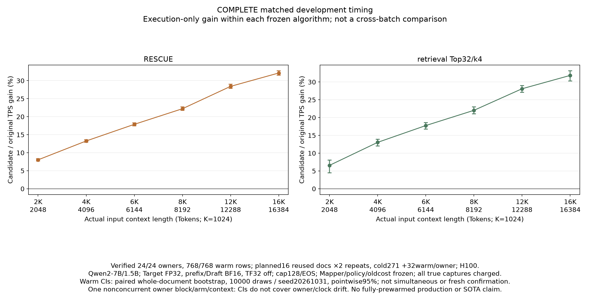
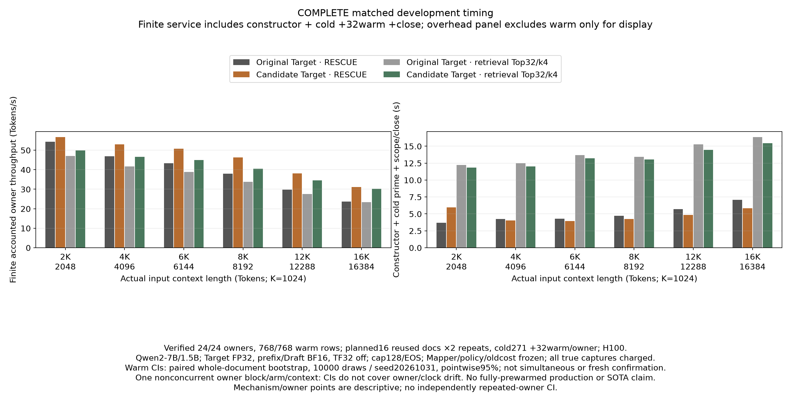
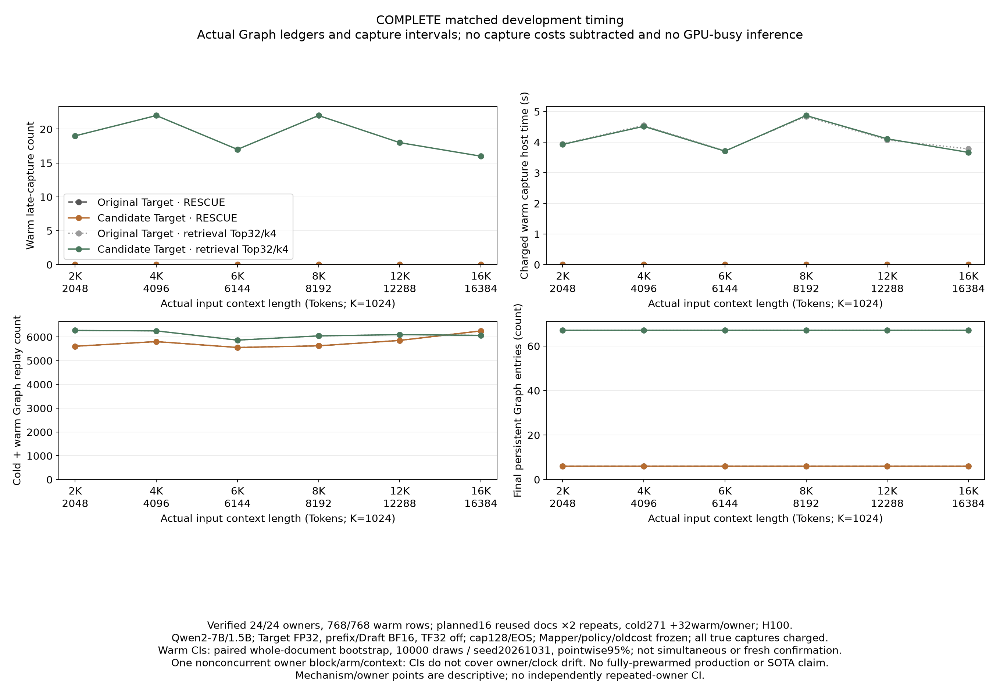
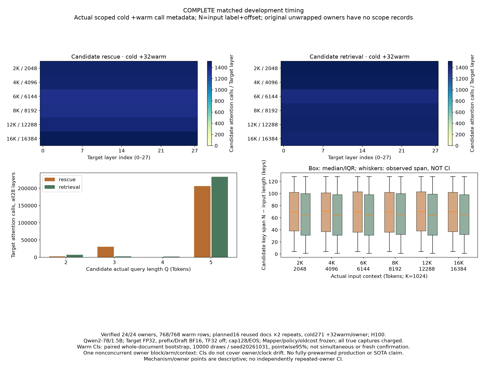
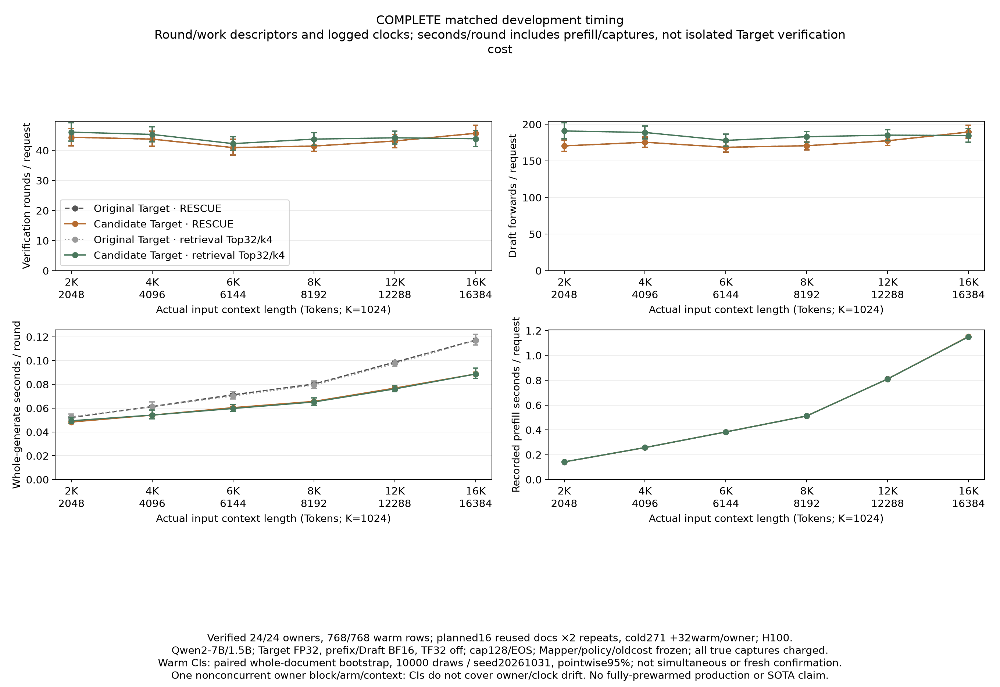

# Matched four-arm FP32 split-KV development timing

Status: `COMPLETE_MATCHED_DEVELOPMENT_TIMING`.

Saved counts: `{'prime_requests': 24, 'timing_requests': 768, 'owners': 24}`; raw evidence complete: `True`; preregistered scientific gate: `False`.

Primary comparison: candidate RESCUE versus candidate retrieval Top32/fixed-k4 Graph. Both receive the same new Target execution. The original RESCUE/original retrieval comparison is separately remeasured in this same batch, alongside each method’s candidate/original execution gain. There is no ordinary-SD arm and no division by timings from the earlier context curve. Retrieval Top32/k4 is the frozen strong representative, not a claim that it is globally optimal or the original paper implementation.

Primary TPS is the sum of saved warm output Tokens divided by the sum of actual frozen-curve whole-generate elapsed seconds per arm/context. Each private owner serves cold document271 then the same32 warm calls (16 reused development documents, two repeats). All true request-time Triton JIT, Graph captures, warmups and restoration stay charged. The Target proxy’s metadata append is retained. The timer begins after outside-generate telemetry/seed/idle and ends before row normalization. Shared model loading/preparation and service infrastructure are not included. This is not fully-prewarmed production or network-service TPS.

Acceptance length (accepted draft Tokens / verification rounds), acceptance rate (accepted / proposed) and TPS are separately plotted. Bootstrap resamples whole paired documents, keeping both repeats and all four arms together, with one shared index across all six contexts: 10000 draws, seed20261031, pointwise95% percentile intervals. These are not simultaneous intervals. One nonconcurrent owner block per context/arm, despite balanced fixed order, means document CIs do not capture owner-level noise, clock drift or block-order effects. The16 documents were already used; this is not fresh confirmation, general stochastic distribution equivalence, production or SOTA evidence.

The preregistered gate requires every one of the six primary point gains to exceed10%, each corresponding pointwise95% CI lower bound to exceed0, and all792 evaluated outputs to exactly equal the original sealed canonical Tokens. The CI is not required to have lower bound>10%; that stronger claim is not made. Raw completion alone is not scientific success. Rendered inspection and independent audit remain required.

Mapper, policy and old cost table stay byte-frozen; Target tensors are FP32 with TF32 flags disabled, prefix and Draft BF16. This is not an intermediate-state bitwise or compiled-instruction equivalence claim. The separately preserved operator V1/V2 failures and V3 analytic smoke are not relabeled. The48-call model Token gate is an authenticated predecessor, not timing evidence. This792-call run checks its own saved outputs against the old canonical references.

## Primary fair comparison

|Actual input Tokens|Candidate RESCUE TPS|Candidate retrieval TPS|Relative gain %|Paired95% CI %|Point>10|CI lower>0|Statistical gate|
|---:|---:|---:|---:|---|---|---|---|
|2048|59.731041|56.286238|6.120151|[0.526006,12.364856]|False|True|False|
|4096|54.057189|52.177996|3.601504|[-2.733891,11.475422]|False|False|False|
|6144|51.756123|50.752908|1.976664|[-3.080945,8.001367]|False|False|False|
|8192|47.048614|44.903783|4.776506|[0.388548,10.003283]|False|True|False|
|12288|38.636210|38.043885|1.556952|[-2.443704,6.066674]|False|False|False|
|16384|31.590836|32.900315|-3.980141|[-7.861802,-0.300733]|False|False|False|

## All four prespecified throughput contrasts

|Actual input Tokens|Contrast|Point gain %|Paired95% CI %|
|---:|---|---:|---|
|2048|primary_candidate_rescue_vs_candidate_retrieval|6.120151|[0.526006,12.364856]|
|2048|original_rescue_vs_original_retrieval|4.698579|[0.223418,9.569352]|
|2048|rescue_execution_gain|8.006384|[7.708154,8.343738]|
|2048|retrieval_execution_gain|6.559544|[4.434643,8.011338]|
|4096|primary_candidate_rescue_vs_candidate_retrieval|3.601504|[-2.733891,11.475422]|
|4096|original_rescue_vs_original_retrieval|3.392455|[-2.525878,10.632381]|
|4096|rescue_execution_gain|13.247055|[12.869249,13.587674]|
|4096|retrieval_execution_gain|13.018543|[11.998004,13.906850]|
|6144|primary_candidate_rescue_vs_candidate_retrieval|1.976664|[-3.080945,8.001367]|
|6144|original_rescue_vs_original_retrieval|1.867889|[-2.778350,7.253880]|
|6144|rescue_execution_gain|17.866553|[17.427853,18.306494]|
|6144|retrieval_execution_gain|17.740829|[16.760932,18.570866]|
|8192|primary_candidate_rescue_vs_candidate_retrieval|4.776506|[0.388548,10.003283]|
|8192|original_rescue_vs_original_retrieval|4.620233|[0.625900,9.254658]|
|8192|rescue_execution_gain|22.200335|[21.746163,22.729255]|
|8192|retrieval_execution_gain|22.018074|[21.006999,22.971606]|
|12288|primary_candidate_rescue_vs_candidate_retrieval|1.556952|[-2.443704,6.066674]|
|12288|original_rescue_vs_original_retrieval|1.301182|[-2.251801,5.217563]|
|12288|rescue_execution_gain|28.405070|[27.815753,28.968550]|
|12288|retrieval_execution_gain|28.081683|[27.095955,28.992631]|
|16384|primary_candidate_rescue_vs_candidate_retrieval|-3.980141|[-7.861802,-0.300733]|
|16384|original_rescue_vs_original_retrieval|-4.187729|[-8.190813,-0.468338]|
|16384|rescue_execution_gain|32.113911|[31.522755,32.725964]|
|16384|retrieval_execution_gain|31.828290|[30.261137,33.127090]|

## Acceptance descriptors (not interchangeable with TPS)

|Input Tokens|Arm|Accepted/round|Paired95% CI|Accepted/proposed|Paired95% CI|
|---:|---|---:|---|---:|---|
|2048|original_rescue|1.900000000|[1.7275132275132274, 2.0978915662650603]|0.541549578|[0.49469294920394236, 0.592055522375802]|
|2048|candidate_rescue|1.900000000|[1.7275132275132274, 2.0978915662650603]|0.541549578|[0.49469294920394236, 0.592055522375802]|
|2048|original_retrieval|1.791044776|[1.6149936467598476, 1.9854656436696256]|0.460251046|[0.41414083910017546, 0.5108291791835372]|
|2048|candidate_retrieval|1.791044776|[1.6149936467598476, 1.9854656436696256]|0.460251046|[0.41414083910017546, 0.5108291791835372]|
|4096|original_rescue|1.937142857|[1.7719298245614035, 2.1059298722398303]|0.528861154|[0.4873755513300774, 0.5707291195191599]|
|4096|candidate_rescue|1.937142857|[1.7719298245614035, 2.1059298722398303]|0.528861154|[0.4873755513300774, 0.5707291195191599]|
|4096|original_retrieval|1.835862069|[1.6892848854076008, 1.9956268221574345]|0.472824156|[0.43491350460487166, 0.5140612704110447]|
|4096|candidate_retrieval|1.835862069|[1.6892848854076008, 1.9956268221574345]|0.472824156|[0.43491350460487166, 0.5140612704110447]|
|6144|original_rescue|2.140458015|[1.934379457917261, 2.340909090909091]|0.574119574|[0.5246779272087161, 0.6206459007701752]|
|6144|candidate_rescue|2.140458015|[1.934379457917261, 2.340909090909091]|0.574119574|[0.5246779272087161, 0.6206459007701752]|
|6144|original_retrieval|2.045857988|[1.884992987377279, 2.216857144598284]|0.527057927|[0.48468059852509093, 0.5721774193548387]|
|6144|candidate_retrieval|2.045857988|[1.884992987377279, 2.216857144598284]|0.527057927|[0.48468059852509093, 0.5721774193548387]|
|8192|original_rescue|2.104072398|[1.961063419182251, 2.247244094488189]|0.558446757|[0.5240637596113684, 0.5936745398889584]|
|8192|candidate_rescue|2.104072398|[1.961063419182251, 2.247244094488189]|0.558446757|[0.5240637596113684, 0.5936745398889584]|
|8192|original_retrieval|1.941428571|[1.8040816326530613, 2.088455772113943]|0.500552486|[0.4654743331706808, 0.5382830626450116]|
|8192|candidate_retrieval|1.941428571|[1.8040816326530613, 2.088455772113943]|0.500552486|[0.4654743331706808, 0.5382830626450116]|
|12288|original_rescue|1.978260870|[1.8342541436464088, 2.1452599388379205]|0.524394929|[0.4883888084074096, 0.5644135359126775]|
|12288|candidate_rescue|1.978260870|[1.8342541436464088, 2.1452599388379205]|0.524394929|[0.4883888084074096, 0.5644135359126775]|
|12288|original_retrieval|1.909476662|[1.7708894878706198, 2.0579494799405644]|0.490730643|[0.4549853697187492, 0.530019120458891]|
|12288|candidate_retrieval|1.909476662|[1.7708894878706198, 2.0579494799405644]|0.490730643|[0.4549853697187492, 0.530019120458891]|
|16384|original_rescue|1.815321477|[1.660621761658031, 1.9696531791907514]|0.470734303|[0.43043682017276597, 0.5106623769203328]|
|16384|candidate_rescue|1.815321477|[1.660621761658031, 1.9696531791907514]|0.470734303|[0.43043682017276597, 0.5106623769203328]|
|16384|original_retrieval|1.930199430|[1.7563587684069613, 2.1166666666666667]|0.497247706|[0.4523809523809524, 0.544640247060622]|
|16384|candidate_retrieval|1.930199430|[1.7563587684069613, 2.1166666666666667]|0.497247706|[0.4523809523809524, 0.544640247060622]|

## Descriptive interaction (not an additional success gate)

Multiplicative interaction is `[(candidate_rescue/original_rescue)/(candidate_retrieval/original_retrieval)-1]×100`. The second descriptor is primary relative gain minus original relative gain, in percentage points. Neither adds a new hard gate.

|Input Tokens|Ratio-of-execution-gains interaction %|Primary minus original relative gain (pp)|
|---:|---:|---:|
|2048|1.357776|1.421573|
|4096|0.202190|0.209049|
|6144|0.106780|0.108775|
|8192|0.149372|0.156273|
|12288|0.252485|0.255770|
|16384|0.216661|0.207588|

## Finite owner clocks and captures

Finite service TPS includes constructor/scope setup + cold prime +32warm +scope/owner close. Constructor/close are outside the primary warm clock but are not hidden: they are reported here and included in finite service. One owner per arm/context provides no independently repeated-owner CI. Capture host intervals are recorded subintervals, not GPU-busy time or a removable speed upper bound. Cold means first request in a fresh private owner, not independent process/model cold start: the single process/cache can retain compiled kernels from preceding owners. Compilation is charged wherever it actually occurs, never reset or subtracted for a hypothetical deployment. Seconds/round includes prefill and capture work, not isolated Target verification cost.

|Input Tokens|Arm|Constructor s|Cold s|Warm32 s|Scope/close s|Finite service TPS|Warm late captures|Charged warm capture s|
|---:|---|---:|---:|---:|---:|---:|---:|---:|
|2048|original_rescue|0.021407|3.650665|74.064363|0.026617|54.318855|0|0.000000|
|2048|candidate_rescue|0.038628|5.815075|68.574061|0.100045|56.676831|0|0.000000|
|2048|original_retrieval|0.019892|12.078918|77.544336|0.111681|47.061537|19|3.943496|
|2048|candidate_retrieval|0.022877|11.588874|72.770897|0.216825|49.929389|19|3.928312|
|4096|candidate_retrieval|0.019854|11.768915|78.500523|0.207214|46.675836|22|4.518804|
|4096|original_retrieval|0.017315|12.390072|88.720147|0.057241|41.745411|22|4.550756|
|4096|candidate_rescue|0.030408|3.885729|75.771606|0.104021|52.937795|0|0.000000|
|4096|original_rescue|0.026989|4.219802|85.809112|0.012080|46.897909|0|0.000000|
|6144|candidate_rescue|0.032086|3.803484|79.140395|0.102374|50.843577|0|0.000000|
|6144|candidate_retrieval|0.020107|12.987882|80.704735|0.203994|44.976018|17|3.708726|
|6144|original_rescue|0.027942|4.227425|93.280055|0.012153|43.301948|0|0.000000|
|6144|original_retrieval|0.019161|13.564944|95.022423|0.117559|38.850636|17|3.717062|
|8192|original_retrieval|0.019150|13.316742|111.301543|0.112629|33.859702|22|4.841485|
|8192|original_rescue|0.029195|4.656204|106.386251|0.011546|38.025554|0|0.000000|
|8192|candidate_retrieval|0.022309|12.791273|91.217259|0.216429|40.519047|22|4.872243|
|8192|candidate_rescue|0.031318|4.109740|87.058887|0.103616|46.263256|0|0.000000|
|12288|original_rescue|0.028902|5.648855|136.128043|0.011856|29.784726|0|0.000000|
|12288|original_retrieval|0.020671|15.136267|137.899316|0.113584|27.577231|18|4.073802|
|12288|candidate_rescue|0.032446|4.727779|106.014538|0.106789|38.094705|0|0.000000|
|12288|candidate_retrieval|0.020937|14.204643|107.665134|0.215590|34.592809|18|4.110797|
|16384|candidate_retrieval|0.021636|15.229784|124.497287|0.208212|30.180716|16|3.667923|
|16384|candidate_rescue|0.031278|5.678622|129.657852|0.118347|31.176630|0|0.000000|
|16384|original_retrieval|0.019152|16.192084|164.122645|0.119900|23.407656|16|3.783596|
|16384|original_rescue|0.030114|7.049142|171.296059|0.012490|23.678749|0|0.000000|

## Mechanism and unchanged-work evidence

Original variants must match the old historical work at matching document/context/repeat; every variant must match its own repeated trajectory. Candidate-versus-original differences are descriptive and allowed, provided canonical output Tokens agree. Scope call counts are actual returned proxy invocations, not kernel timings; the original unwrapped variants deliberately have no proxy records. Full hidden-state equality is not measured by this timing run.

|Context|Method|Paired rows|Changed-work rows|Different semantic trajectories|
|---:|---|---:|---:|---:|
|2048|rescue|32|0|0|
|2048|retrieval|32|0|0|
|4096|rescue|32|0|0|
|4096|retrieval|32|0|0|
|6144|rescue|32|0|0|
|6144|retrieval|32|0|0|
|8192|rescue|32|0|0|
|8192|retrieval|32|0|0|
|12288|rescue|32|0|0|
|12288|retrieval|32|0|0|
|16384|rescue|32|0|0|
|16384|retrieval|32|0|0|

## Figures

[acceptance_length PNG](acceptance_length.png) · [SVG](acceptance_length.svg)

[acceptance_rate PNG](acceptance_rate.png) · [SVG](acceptance_rate.svg)

[warm_tps PNG](warm_tps.png) · [SVG](warm_tps.svg)

[relative_tps_gain PNG](relative_tps_gain.png) · [SVG](relative_tps_gain.svg)

[execution_gains PNG](execution_gains.png) · [SVG](execution_gains.svg)

[finite_owner_costs PNG](finite_owner_costs.png) · [SVG](finite_owner_costs.svg)

[graph_mechanisms PNG](graph_mechanisms.png) · [SVG](graph_mechanisms.svg)

[target_scope_calls PNG](target_scope_calls.png) · [SVG](target_scope_calls.svg)

[round_work PNG](round_work.png) · [SVG](round_work.svg)

## Evidence issues

None in saved-data checks.

## Limitations and collection provenance

A saved collection receipt is a transcription of tool observations checked against local SHA/size inventories. This report does not re-observe the remote machine, certify a signed attestation, transfer weights, or claim a full remote compiled-cache inventory.

## Portable source and raw results

[Saved single-file source](analysis_entry.py). Reproduce with `python analysis_entry.py /absolute/raw/root --curve-proof-root /absolute/analysis/proof/curve --model-proof-root /absolute/analysis/proof/model --output /absolute/fresh/output`. Only stdlib+NumPy/Matplotlib are required; no runtime/repo imports.

[results/PRIME.jsonl](../results/PRIME.jsonl)
[results/RUNTIME.jsonl](../results/RUNTIME.jsonl)
[results/OWNERS.jsonl](../results/OWNERS.jsonl)
[results/WORK_DIFFERENCES.jsonl](../results/WORK_DIFFERENCES.jsonl)
[results/TERMINAL.json](../results/TERMINAL.json)
[COLLECTION_RECEIPT.json](../COLLECTION_RECEIPT.json)
