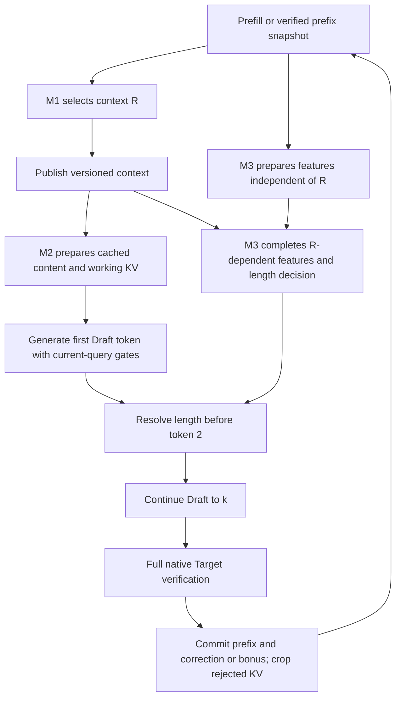

# RESCUE execution system

This package runs the complete three-module greedy speculative-decoding loop
for the available Qwen2 checkpoints. The former pipeline remains under
`exp/attention_pipeline`; its sources and saved results are unchanged.

The runnable model backend currently places Target and Draft on one device.
The length-policy service can run in another CPU process or on a reachable
trusted host. This is **not** a deployment that transfers Target KV to a
separate edge Draft model. Context and length use separate interfaces so that
such a model adapter can be added without bundling their delivery.

## Execution and module contracts



| Component | Input | Output / ownership |
|---|---|---|
| `ContextSelector` | Completed-prefix T/S attention and each model's native V | Sorted R at an actual token budget |
| `ContentInjector` | R, completed Teacher V, native Draft V, frozen layer pairing, current layer state | V correction inside privately owned working KV |
| `Scheduler` | Shared snapshot, R-dependent features, frozen risk checkpoint, actual-engine cost | Versioned length packet, or explicit safe fallback |
| `RescueEngine` | Prompt token IDs, configuration, modules | Verified output, accepted/proposed counts, timings and round trace |

M1 and M3 overlap their independent work in async mode. M3 still needs R to
finish its original feature contract; the implementation does not pretend
that the complete decision is independent of selection. It preserves the
frozen attention/read predictor rather than silently changing its inputs.
This release does not retrain a controller on injection-conditioned states.

Only the first Draft token is unconditional because all allowed k are >=1.
The engine waits at the token-2 deadline if necessary. Request UUID, round,
committed prefix and workset version reject stale decisions. Errors in the
network channel close its socket and produce a logged conservative length;
they never cause a stale response to be used in another round. One engine
owns one active request; concurrent calls are rejected rather than sharing KV.

## System optimizations

- `NativeCache` preallocates Target/Draft K/V and appends only new states.
  Cropping rolls back valid lengths; rejected storage is overwritten before
  reuse. There is no per-token concatenation of the full history.
- `WorkingCache` gathers all layers' historical K/V in two batched reads per
  round, then appends query states during Draft generation. Native and working
  stores expose per-layer views of contiguous storage. RoPE positions remain
  absolute positions in native history. The optional incremental backend
  updates changed slots and restores prior working-V corrections before reuse.
- `ContentInjector` memoizes immutable committed-position projections,
  native-content features and residual directions for the request. Attention
  prior and positional features refresh each round; immutable content-affine
  terms are also cached per committed position. Gates use each current query.
  Corrections overwrite only the working V buffer, eliminating the
  previous per-query clone of its entire V. Target/backing V stay native.
- Target observations retain only the last attention layer; prefill keeps a
  compact last-query row. Draft saves last-layer Q during drafting, then
  computes one full-key shadow at the committed prefix for the next round.
  The terminal round skips that unused probe. Unused layer capture, vocabulary confidence softmax,
  training regularizers and gate statistics are not computed.
- Draft supports an eager compatibility backend and fused PyTorch SDPA.
  The latter can change Draft floating-point results; exact Target validation
  remains mandatory. Target retains eager FP32 attention.
- Length scoring evaluates the menu in one vectorized call. Training-only
  calibration measures this implementation's student and verification costs.
- Optional chunked prefill bounds attention's query dimension, with both
  native caches fully retained. It is not a student-prefill bypass or a claim
  that a long-context model benchmark has already been completed.
- `auto` uses serial execution on a low-latency local GPU and async execution
  with a separate length endpoint. Shared-device async remains available for
  measured comparisons; hiding a wait is not a guarantee of zero contention.

## Context selection

`coverage` is the attention-weighted marginal-content-coverage selector.
Cosine similarity is computed inside each model's native flattened KV-head
V space; each model's free-history weights are normalized after zeroing
mandatory anchors. Scalar marginal gains are combined with `student_weight`. The first
position and recent positions are mandatory. High joint attention restricts
the candidate pool. Token mode uses batched greedy selection (default16),
which does not update redundancy within a batch. It is an approximation, not
an exact submodular optimum or a semantic-information measure.

`chunk_size >1` selects coverage chunks by gain per retained token, updating
coverage after each chosen chunk; the final chunk may be partial to enforce
the same token budget. `teacher` and `joint` provide attention-ranking
controls. `read_joint` retains the historical read-preservation selector as
a separate compatibility control. `full` uses native full context.

Expensive context refresh occurs every four rounds by default. Between
refreshes, carry selection maintains the exact budget and mandatory recent
positions; it does not grow the workset without bound. Coverage effectiveness
and refresh-policy quality require their own matched experiments; runtime
correctness and system speed do not isolate either contribution.

## Run local inference

Run from the repository root with local base models and mapper/risk weights.
The tested environment is Python3.10, PyTorch2.7.1+cu128, Transformers4.40.2:

```bash
PYTHONDONTWRITEBYTECODE=1 /home/wanghl/miniconda3/envs/rescue/bin/python -m rescue \
  --prompt-file prompt.txt --verify \
  --cost exp/system_validation/out_validation_v1_20261017/calibrated_cost.json
```

Teacher/Draft paths and module paths can be overridden. Token vocabularies
must match. The installed Qwen2 attention adapter is the supported model API;
other architectures require an explicit backend and compatible mapper.
Checkpoint tensors are local ignored artifacts and are not bundled by Git.

Relevant options are `--selector`, `--budget`, `--recent`, `--chunk-size`,
`--refresh-every`, `--attention-backend`, `--schedule`, `--no-injection`,
`--max-new-tokens` and `--prefill-chunk-size`. A new hardware/backend cost
profile should be calibrated rather than copied from a different machine:

```bash
python -m rescue.calibration --output local_cost.json --documents 2
```

This command uses the repository's declared training split, three fixed
horizons, and independent Target references. It writes timing samples and
positive cost coefficients; it does not fit new mapper or risk weights.
Without `--cost`, inference uses the older frozen cost profile for functional
compatibility, not a claim of optimal current-system horizon selection.

## Separate length process

Start the actual TCP CPU inference service in another terminal:

```bash
python -m rescue.length_server \
  --checkpoint exp/attention_horizon/out/risk_attention_read_42.pt \
  --host 127.0.0.1 --port 9123
python -m rescue --prompt-file prompt.txt --verify \
  --length-endpoint 127.0.0.1:9123 --schedule auto \
  --cost exp/system_validation/out_validation_v1_20261017/calibrated_cost.json
```

Only the 31 scalar features, timing coefficients, identity and horizon bounds
cross this channel. It uses bounded length-prefixed JSON, persistent TCP and
finite timeouts. It does not deserialize arbitrary network Python objects.
The default bind is loopback; this research transport does not supply TLS or
authentication for public deployment.

## Verification and benchmarking

```bash
PYTHONDONTWRITEBYTECODE=1 python -m unittest discover -s tests -v
PYTHONDONTWRITEBYTECODE=1 python -m rescue.benchmark \
  --output exp/system_validation/new_run --split validation \
  --documents 8 --repeats 2 --max-new-tokens 64
python -m rescue.audit exp/system_validation/new_run
```

The benchmark records frozen source copies, checkpoint/data hashes, explicit
mode configurations, training calibration, Target references, randomized
request order, raw per-round records and document-paired intervals. Its modes
separate the former pipeline, compatible new engine, fused/memoized engine,
coverage/reuse/calibrated policy, and actual TCP CPU policy service.

These are the existing research splits, not new independent confirmation
data. Output agreement verifies the saved greedy executions; it does not
establish sampling correctness, all precisions, isolated module novelty, or
net speedup over Target AR. See the recorded system report for measured scope.

The earlier `benchmark` modes already contain intervention modules. For lean
native full-context SD and a Qwen2 port of SpecExtend chunk retrieval, run:

```bash
python -m rescue.compare_baselines --output exp/system_validation/new_baselines_run
python -m rescue.comparison_audit exp/system_validation/new_baselines_run
```

This selects fixed horizons on training documents before evaluation and
includes both 512/1024-token retrieval budgets plus fixed-k4 native SD. The
native path disables attention probes and working-cache copies. The SpecExtend
control ports retrieval only; it does not reproduce the original Vicuna tree
engine, Flash prefill, or hybrid tree attention. See the
[comparison protocol](../exp/system_validation/BASELINE_COMPARISON.md).

## Critical-path optimization

The next [system audit and matched optimization run](../exp/system_validation/SYSTEM_OPTIMIZATION.md)
keeps the same 16/16 draft-length/acceptance trajectories while improving
document-paired decode/whole-request TPS by 4.94%/3.38% against legacy execution.
Common GQA/cache/catchup improvements also apply to the native and retrieval
baselines; the complete method still trails both. Fixed-k4 and training-only
hazard calibration do not establish an additional length-policy speedup.

Optimized execution is on by default. It uses native GQA in Draft SDPA,
direct working-cache gathers, factored static/query gate affine terms, lazy
read states and state-only catchup. `--legacy-execution` retains old execution.
`--length-policy fixed --fixed-k 4` is an explicit length-module ablation.

An optional calibration is bound to the original risk checkpoint SHA256:

```bash
python -m rescue --prompt-file prompt.txt --verify \
  --cost exp/system_validation/out_optimization_v1_20261017/cost.json \
  --risk-calibration exp/system_validation/out_optimization_v1_20261017/risk_calibration.json
```

The same `--risk-calibration` option is accepted by `rescue.length_server`.
It folds two training-fitted parameters into existing risk weights, without
an additional runtime network. It is not automatically enabled, and its
training likelihood improvement did not produce a stable net speed benefit.

```bash
python -m rescue.optimization --output exp/system_validation/new_optimization_run
OMP_NUM_THREADS=4 python -m rescue.optimization_audit exp/system_validation/new_optimization_run
```

The subsequent [execution reuse and routing run](../exp/system_validation/EXECUTION_REUSE.md)
adds deferred full-key probes, committed-position gate-affine memoization and
batched working-KV reads. These are enabled by default; the existing mapper,
risk checkpoint and four-layer injection policy remain unchanged. To recover
the previous execution organization while keeping the common storage layout:

```bash
python -m rescue --prompt-file prompt.txt --verify \
  --working-mode layerwise --eager-probes --round-gate-affine
```

`--working-mode incremental` keeps unchanged historical slots. It must restore
the original V before reusing previously corrected slots; it does not keep
accumulating corrections. Physical slot order can change Draft floating-point
reductions, so this is an explicit optional backend.

Injection work can be restricted with `--injection-layers` (zero-based mapper
layer IDs), `--inject-tokens`, and `--injection-strength`. Unselected layers
skip memo allocation and query-gate execution. `--injection-rule joint` shares
M1's T/S joint attention ranking; it does not share the selector's full greedy
coverage gain, and the gate still receives its original Teacher prior.
These are static route options, not a newly trained per-query router. An empty
layer list, zero token budget or zero strength skips injection. The ordinary
default retains all four mapper layers; training-selected lighter routes are
explicit experimental configurations.

On the reused eight-document validation split, pure execution improves paired
whole-request TPS by 0.99% with 16/16 risk trajectories unchanged. The train-selected
layer-27/64-position route improves whole-request TPS by 2.91% versus the new
four-layer fixed-k4 control, but remains 6.15% below native SD. It has no established
gain over disabling injection; zero-allowed training selects no injection. This
does not establish a successful full method or dynamic-length policy. There are
192 exact validation outputs, 31 passing CPU tests and 32 audited frozen sources.

```bash
python -m rescue.reuse_benchmark --output exp/system_validation/new_reuse_run
OMP_NUM_THREADS=4 python -m rescue.reuse_audit exp/system_validation/new_reuse_run
```

## Experimental long-context path

The next [long-context implementation and protocol](../exp/long_system/README.md)
adds efficient SDPA Target/prefill attention with compact Q observations,
`hierarchical` bounded-support coverage, relative-coverage/drift refresh,
optional immutable QKV/MLP packing, last-layer joint-rollout replay and a
36-feature injection-aware length model. These remain explicit options;
the historical default checkpoint/backend is preserved.

```bash
python -m rescue --prompt-file prompt.txt --verify --efficient-attention \
  --prefill-precision bfloat16 --pack-projections --selector hierarchical \
  --coverage-rows 64 --refresh-policy adaptive --attention-drift 0.2 \
  --coverage-floor 0.75 --injection-layers 27 --inject-tokens 64 \
  --length-policy fixed --fixed-k 4
```

This is an example configuration, not a claim that it wins. BF16 prefill
changes numerical behavior and is checked against a matched Target reference.
The hierarchical support objective approximates the previous full-history
coverage objective; it is not an implementation-equivalent optimization.
Packing must run after final model device/dtype placement. Shared packed
projections require sequential engine execution, not concurrent serving.

The new risk group receives the first token's actual gate/residual/attention
summary before deciding token 2. It supports local serial/async scheduling;
the existing 31-feature TCP wire contract does not support this 36-feature
checkpoint and rejects that combination. The complete SpecExtend comparison
ports its archived tree/retrieval/hybrid flow to Qwen2 with a common FP32
prefix-attention kernel and shared Target prefill. It is separate from both
the lean retrieval control and the published Vicuna/FP16 benchmark.

The [goal-oriented module pilot](../exp/module_objectives/REPORT.md) adds
`rescue.objectives` work/fidelity accounting, `rescue.objective_audit` training-only
horizon utility calibration, `rescue.module_study` common-prefix and matched SD
diagnostics, and `rescue.module_report` saved-record verification.
`--early-length-publish` releases the first-token injection summary inside its
last attention layer for asynchronous overlap; local auto scheduling remains
serial. `--profile` records host/stream phase intervals for separate diagnostic
runs. These intervals include queueing/idle and may overlap, so they cannot be
summed as active kernel costs. The final runtime TPS uses unprofiled requests.
Utility checkpoints may include an explicit conditional depth-prior mixture;
a pure prior skips unused attention features and is a featureless control,
not evidence for the value of attention. Checkpoint changes remain explicit.

The subsequent [module-metric optimization](../exp/module_opt/REPORT.md) adds
`QueryValueMapper` checkpoint kinds `query_residual` and
`query_attention_residual`. They preserve native K/backing V and add a cached
low-rank query-conditioned vector direction; the second also conditions on
actual Student Q/K read weights. It does not inject Teacher K. The latter did
not outperform the simpler query head in the three-document pilot.

`--coverage-anchor-fraction` and `--coverage-attention-weight` expose optional
hierarchical selection experiments; both default to zero. Their tested nonzero
settings degraded rolling quality and are not promoted. The 34-input
`attention_injected_light` risk group skips unused read-error computation but
still consumes the 36-slot local feature contract. `FeedbackRisk` checkpoints
use only past verified outcomes and reset at every request; `ratio` reduces
some waste, while `surplus` generated too long in confirmation. Neither has
established net acceleration. All these 36-slot variants, including featureless
wrappers, reject the old 31-feature TCP service before allocating resources.

Reproduction uses `rescue.module_opt_data`, `rescue.module_opt_run`,
`rescue.module_opt_report`, `rescue.module_key_run` and
`rescue.module_key_report`; frozen source, cohort hashes and checkpoints are
bound in each stage's protocol. New weights/options require explicit selection;
the historical defaults and the earlier paused held-out test are preserved.

The in-progress [internal architecture study](../exp/module_arch/REPORT.md)
adds checkpoint kind `native_residual_query` and risk kind `step_budget`.
The former predicts an increment relative to native V with compact source/native
encoders. The latter reads 12 causal features after two draft tokens and chooses
2 or 4; it supports local execution only. Its short-rollout likelihood keeps
unobserved continuations censored. The experiment trains the whole final-layer
mapper with prefix-aware margin/preservation loss and recollects changed states.
New modules remain explicit checkpoints. Training/partial runs do not establish
content-transfer benefit or acceleration; see the frozen per-stage protocol.

## Round-overhead execution reuse (2026-10-19)

This code-only update leaves model weights, attention normalization/features,
selection budgets, length thresholds, exploration RNG and EOS rules unchanged:

- The online engine uses optional `StepBudget.decide_cap`, which omits the
  unused relative-rate score and its host scalar read. The host read needed for
  the actual 2/4 action remains. The original `decide` diagnostic API and older
  stepwise policies are supported.
- Three nonpersistent buffers store six geometry cases: remaining-output
  budgets 1 through 5 and the saturated case >=6. The five-token boundary must remain distinct:
  four accepts plus the bonus exhaust it, so no Draft catchup is needed.
  Costs are read afresh with the original floating-point expression. Existing
  checkpoint/state_dict fields are unchanged.
- Runtime `ReadState`/`LazyReadState` eagerly compute the normalized head mean
  once, before the planner's existing ready event. Selection, Mapper binding
  and length features share this read-only round snapshot. Legacy states use
  an uncached fallback; subset/head-specific reductions are unchanged. Coverage
  still clones its weights before masking, and no new stream synchronization
  or Teacher query is introduced. Some full-context/fixed/no-injection controls
  did not previously need the Student mean; no all-configuration speedup is
  claimed.

Regression coverage is in `tests/test_rescue_attention_summary.py`,
`tests/test_rescue_step_budget_fast.py` and `tests/test_rescue_round_overhead.py`.
The last compares cached execution with uncached rules using nonzero query-V
corrections: selected positions, features, draft/check tokens, caps, acceptance,
refreshes, work counts and canonical Target outputs, including request reset
and serial/async CPU scheduling. Optional CUDA tests cover device-moved geometry
and producer/planner stream ordering; they skip when CUDA is unavailable.

Run `python -m unittest discover -s tests -v`. The local validation environment
is Python 3.12, PyTorch 2.7.1 CPU and Transformers 4.40.2. The CPU regressions
alone do not establish a GPU speedup.

The subsequent [H100 execution-only validation](../exp/round_overhead/out_h100_v1_20261019/results/analysis_final/REPORT.md)
is complete: 4 independent warmups, 12 Target AR references, 24 correctness
requests and 72 observer-free paired timing requests. The existing nonzero
Mapper and StepBudget are frozen. All selected positions, causal features,
draft/check tokens, 2/4 decisions, acceptance trajectories and canonical outputs
remain identical. All 26 server-side targeted tests, including the two CUDA
checks, pass. Six reused development documents have exact 4096/8192-token
inputs, output limits 128 and three repeats; this is not a fresh held-out test,
RTX 4090 measurement, or comparison against SpecExtend/native SD.

The joint three-change whole-request TPS effects are only +0.1671% at 4K
(paired document 95% CI -0.0485% to +0.3961%) and +0.1557% at 8K
(+0.0504% to +0.2648%). Acceptance-length deltas are exactly zero. The strict
both-context speed criterion is not met; these changes do not establish a
material full-system acceleration or isolate any individual optimization.
The raw requests, source/asset hashes, report, separate acceptance/TPS figures
and stage-latency diagnostics are linked from that report. The paused held-out
matrix remains untouched.

## Optional resident Draft and single-token CUDA Graph (2026-10-19)

`--draft-execution resident` reuses device token/position buffers and executes
the Qwen2 single-token body directly. `--draft-execution cuda_graph` additionally
captures that body, not the proposal loop. Both are opt-in; the default remains
`eager`. The next embedding input stays on the GPU, but a host token read still
serves the unchanged per-token EOS check and the causal 2/4 decision after the
second token. This is not a fully device-controlled decoding loop.

The adapter currently requires optimized execution, deferred probes, packed
Working KV, SDPA and local serial scheduling. Unsupported observer, mapper and
scheduling combinations fail explicitly instead of silently falling back.
Native KV writes and Python logical lengths stay outside capture. Each graph
uses the actual Working KV length, stable Mapper shadow bindings and owned
buffers; refreshed bindings are copied before replay. Buffer replacement
invalidates the owner. Query/summary snapshots have independent storage.
Capture warmups restore all touched Working KV before the real replay.
Graph ownership persists across requests only while the same Engine and cache
buffers are reused; closing or growing the buffers requires fresh capture.

The [H100 pilot](../exp/draft_graph/out_h100_v1_20261019/pilot/analysis/REPORT.md)
completed 16 real-model requests: one AR reference, three instrumented
correctness requests and twelve observer-free timing requests in six fresh
Engine sessions. Every session has one cold and one warm request. Frozen
nonzero V-only Mapper, selection and causal 2/4 policy were unchanged; all
output tokens, decisions, selection/features and all valid Native KV/query
byte hashes matched. The server passed 19 targeted tests, including five real
CUDA Graph tests. CPU and conditional CUDA regressions live in
`tests/test_rescue_draft_graph_primitives.py` and
`tests/test_rescue_draft_runtime.py`.

| Mode | Cold request TPS | Warm request TPS | Complete two-request session TPS |
|---|---:|---:|---:|
| Prior optimized eager baseline | 20.0421 | 20.3447 | 19.8601 |
| Resident body | 21.0395 | 21.2691 | 20.7713 |
| Resident + CUDA Graph | 16.9379 | 29.2098 | 20.9815 |

Relative to eager, resident improved cold/warm TPS by 4.98%/4.54%; Graph
changed them by -15.49%/+43.57%. Mean cold capture cost was 0.779 seconds.
The complete-session changes were +4.59% and +5.65%, respectively: Graph adds
only 1.01% over resident in this two-request regime. That session clock includes
intervening raw-record I/O/safety checks and teardown, not just model service.
Model loading is excluded in every mode. Accepted Draft tokens per round stayed
exactly 1.2 (18 accepted, 53 proposed, 15 rounds per request).

These are one reused development document (303), exact 4096-token input,
32-token output and two timing repeats on H100 80GB; Target FP32, Draft/prefill
BF16 and TF32 disabled. Two repeats are not two independent documents: the
figures show timing ranges, not document-level confidence intervals. This
execution pilot does not establish an 8K/128-output, RTX 4090, production-speed,
held-out, or SpecExtend win. Separate acceptance/TPS, session and latency
figures, frozen sources/assets and raw evidence are linked from the report.
The prototype and evidence are local changes, not a GitHub publication.

The subsequent [persistent-owner benchmark](../exp/draft_graph/out_h100_benchmark_v1_20261020/results/analysis_final_v2/REPORT.md)
completed 162 requests on six reused documents at exact 4096/8192 input tokens,
128 output tokens and three timing repeats. Twelve independent AR references
and 36 exactness requests precede six independently measured cold primes and
108 randomized crossover warm requests. Target hooks are explicitly leased to
one Engine at a time, while all cache/Graph owners stay private and persistent.
Every warm Graph request has zero new captures and unchanged buffer pointers.

Graph improves document-paired full-generate TPS versus the prior optimized
eager baseline by **59.6553% [58.8655%, 60.5639%] at 4K**, and **47.4942%
[47.1129%, 47.9420%] at 8K** (95% document bootstrap). Resident alone improves
5.5327% and 4.6869%. Acceptance/outputs and the separate instrumented KV/query,
selection and feature evidence remain identical with actual nonzero injection.
This passes the registered both-context execution-speed gate, not a new
attention/Mapper-quality or external-baseline gate.

For doc303 only, the first 128-token Graph request, including constructor and
818/830 ms capture costs, is 18.25%/16.10% faster at 4K/8K; cold has no document
CI. This does not contradict the older 32-output cold slowdown. Full-generate
warm requests include prefill, hook handoff, cache reset, decode and cleanup;
shared model loading is excluded for all modes. Constructor+one prime+18 warm
requests+close yields accounted active-service gains of 56.81%/45.33%, not
contiguous production-session wall gains. See the report's six PNG/SVG figures
and frozen raw evidence. All 26 server tests, including six real Graph tests,
pass. The default remains eager and unsupported combinations still fail.
